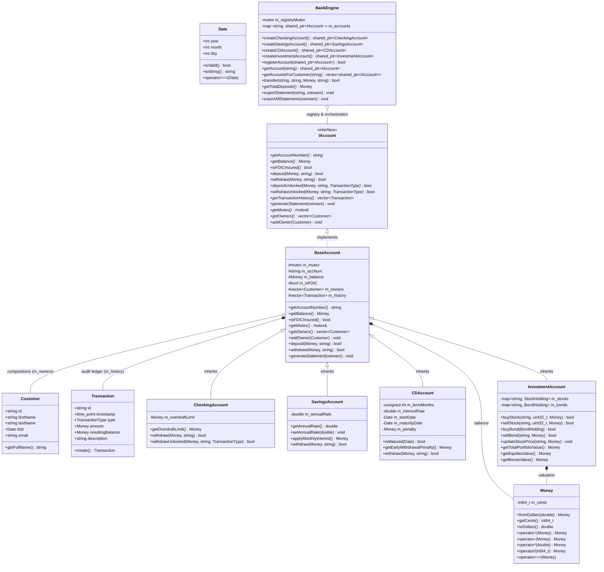

# JBank

### Fast, Thread-Safe Financial & Asset Ledger Engine in Modern C++20

[](https://en.cppreference.com/w/cpp/20)
[](https://cmake.org/)
[]()
[]()
[](LICENSE)

---

## What is JBank?

JBank is a clean, fast banking and asset ledger engine written in **Modern C++20**. 

Most simple banking programs make two major mistakes:
1. **They use `double` or `float` for money.** Computers cannot store decimals like `$0.10` or `$0.20` accurately in binary. Over time, tiny fractions of a cent either vanish or appear out of nowhere.
2. **They freeze when multiple transactions happen at the same time.** If Account A sends money to Account B at the exact same millisecond that Account B sends money to Account A, naive programs lock up permanently (a deadlock).

JBank was built to solve these real-world problems correctly:
* **Exact Pennies (Zero Rounding Errors)**: Tracks money as 64-bit integer cents. $0.10 + $0.20 always equals exactly $0.30.
* **Deadlock-Free Transfers**: Uses modern C++20 locks (`std::scoped_lock`) and per-account locking so transactions run safely and in parallel without freezing.
* **Clean Object Design**: Models shared family/joint accounts using composition instead of messy multiple inheritance, avoiding C++'s infamous "diamond problem."
* **Zero External Dependencies**: Built entirely with the standard C++ library and CMake. No heavy third-party packages, zero memory leaks (100% RAII), and clean compilation with zero compiler warnings under strict flags (`-Wall -Wextra -Wpedantic`).

---

## How the System is Structured

JBank keeps concerns neatly separated: immutable math value types at the bottom, account logic in the middle, and a central coordinating engine on top.

### Class & Component Layout



### High-Level Architecture Flow

```
+====================================================================================+
|                                 APPLICATION LAYER                                  |
|         Interactive CLI (main.cpp)    |    Automated Test Harness (33 Suites)      |
+====================================================================================+
                                          |
                                          v
+====================================================================================+
|                     BANK ENGINE & TRANSACTION ORCHESTRATION                        |
|  - Safe Registry: Manages all active accounts in memory                            |
|  - Deadlock-Free Transfers: Locks both accounts at once using std::scoped_lock     |
|  - Automatic Rollback: If a transfer fails halfway, original funds are restored    |
|  - Audit Export: Writes timestamped transaction records to console and disk        |
+====================================================================================+
                                          |
                                          v
+====================================================================================+
|                                 ACCOUNT TYPES                                      |
|                             <<interface>> IAccount                                 |
|                                       ^                                            |
|                                       |                                            |
|                                  BaseAccount                                       |
|                   +-------------------+-------------------+                        |
|                   |                   |                   |                        |
|            CheckingAccount     SavingsAccount         CDAccount                    |
|           (Overdraft Buffer)  (Monthly APY Comp)   (Maturity & Penalty)            |
|                                       |                                            |
|                                       +-------------------+                        |
|                                                           |                        |
|                                                   InvestmentAccount                |
|                                                (Equities, Bonds, MTM)              |
+====================================================================================+
         |                                       |                      |
         v                                       v                      v
+-----------------------+              +-------------------+   +--------------------+
| DOMAIN OBJECTS        |              | ASSET VALUATION   |   | CORE VALUE TYPES   |
| - Customer Record     |              | - StockHolding    |   | - Money (64-bit)   |
|   (KYC, DOB, Email)   |              |   (Avg Cost, ROI) |   | - Date (Gregorian) |
| - Transaction Record  |              | - BondHolding     |   | - TransactionType  |
|   (Immutable, Timed)  |              |   (Coupon, Yield) |   |                    |
+-----------------------+              +-------------------+   +--------------------+
```

---

## Core Engineering Highlights

### 1. Why Normal Decimal Math Fails (and How JBank Fixes It)

In ordinary software, developers often use `double` for money. That is a dangerous mistake:

```cpp
// The classic computer floating-point bug:
double balance = 0.10 + 0.20; 
// In memory, balance is actually: 0.30000000000000004
```

Over thousands of transactions, those microscopic errors accumulate and corrupt balances.

JBank eliminates this by storing every balance as an **exact 64-bit signed integer count of cents (`int64_t`)**:
* `$1.00` is simply stored as `100`.
* Handles amounts from $-\$92.23\text{ quadrillion}$ to $+\$92.23\text{ quadrillion}$ with zero drift.
* Every math operation (`+`, `-`, `*`, `/`) checks for potential overflow or underflow *before* running and throws an error rather than silently corrupting data.
* Fits inside a single CPU register for maximum efficiency.

### 2. How Transfers Avoid Freezing (Deadlock Prevention)

When moving money between two accounts, standard code locks Account A, then locks Account B. But look what happens under heavy traffic:

```text
Thread 1: Transfers from Account 1 to Account 2 (Locks Acc 1, waits for Acc 2)
Thread 2: Transfers from Account 2 to Account 1 (Locks Acc 2, waits for Acc 1)
Result: Both threads wait on each other forever (DEADLOCK).
```

JBank solves this with three practical mechanisms:
1. **Simultaneous Locking (`std::scoped_lock`)**: Acquires locks on both accounts together using an internal deadlock-avoidance algorithm, preventing circular wait conditions entirely.
2. **Lock Striping**: Each account has its own independent mutex. Account 1 sending to Account 2 never slows down Account 3 sending to Account 4.
3. **Automatic Rollback**: If money is taken out of Account 1, but Account 2 cannot receive it, the money is immediately returned to Account 1. No funds are ever created or lost.

### 3. Avoiding the C++ Diamond Problem (Composition Over Inheritance)

When beginners want a "Joint Checking Account" (shared by two people), they often write:

```cpp
// Bad design: causes duplicate parent data and C++ diamond inheritance bugs
class JointCheckingAccount : public CheckingAccount, public JointAccount { ... };
```

This quickly spirals out of control. You would need `JointSavings`, `JointCD`, and `JointInvestment` classes for every account type.

**JBank's approach:** We used **composition**. 
Every account simply owns a list of authorized customers:
```cpp
std::vector<Customer> m_owners;
```
Want to add a spouse or business partner to an account? Just call:
```cpp
account->addOwner(customer);
```
It works for any account type, dynamically at runtime, without adding duplicate classes or complex inheritance trees.

### 4. Wealth Management & Portfolio Valuation

The `InvestmentAccount` handles multi-asset investments:
* **Dollar-Cost Averaging**: When buying shares at different prices, it tracks the true weighted-average cost per share:
  $$\text{Average Cost Basis} = \frac{\text{Total Money Spent}}{\text{Total Shares Owned}}$$
* **Live Mark-to-Market (MTM)**: Reprices stock holdings against current market feeds to show exact unrealized profits and return on investment:
  $$\text{Unrealized P/L} = (\text{Shares} \times P_{\text{market}}) - (\text{Shares} \times P_{\text{avg}})$$
* **Bonds**: Tracks municipal bonds, fixed interest yields, and maturity dates.
* **Clear Protections**: Models the boundary between FDIC-insured deposit accounts (up to \$250,000) and SIPC investment market risks.

### 5. Modern C++20 Standards

* **Spaceship Operator (`<=>`)**: Default three-way comparisons on all records (`Money`, `Date`, `Customer`, `Transaction`) for clean sorting and comparison.
* **Compile-Time Checks (`constexpr`)**: Evaluates date checks, constructor rules, and enum string conversions at compile time, verified with `static_assert`.
* **Safe Clean Code**: Extensive use of `[[nodiscard]]` so important return values can't be ignored, and `noexcept` on move operations for optimal performance.

---

## File Structure

```text
JBank/
├── CMakeLists.txt              # Standard CMake 3.16+ build setup
├── README.md                   # Project documentation
├── include/
│   ├── Accounts.hpp            # IAccount interface, BaseAccount, Checking, Savings, CD
│   ├── Investment.hpp          # StockHolding, BondHolding, InvestmentAccount
│   ├── JBank.hpp               # BankEngine central registry & transfer logic
│   ├── Money.hpp               # Exact 64-bit integer-cent currency class
│   └── Types.hpp               # Date, Customer, Transaction records
├── src/
│   ├── Accounts.cpp            # Account logic, overdraft checks, CD penalties
│   ├── Investment.cpp          # Stock dollar-cost averaging & bond yields
│   ├── JBank.cpp               # Thread-safe atomic transfers & rollback
│   ├── Money.cpp               # Checked fixed-point arithmetic
│   └── main.cpp                # Showcase demo & interactive operator terminal
└── tests/
    └── test_jbank.cpp          # 33 automated test suites covering all edge cases
```

---

## How to Build and Run

### Prerequisites
* A C++20 compiler (GCC 11+, Clang 13+, or MSVC 2019+).
* CMake 3.16 or newer.

### 1. Build the Project

```bash
git clone https://github.com/Jaba-Ch/JBank.git
cd JBank

# Configure with CMake
cmake -B build -S .

# Build all binaries
cmake --build build
```

This compiles:
1. `jbank_core` (Core static library)
2. `jbank_app` (Interactive CLI demo)
3. `jbank_tests` (Automated test runner)

### 2. Run the Demonstration Showcase

```bash
./build/jbank_app
```

Runs a deterministic demo walking through 6 real scenarios:
1. **Customer Onboarding**: Creates customer records with verified calendar birth dates.
2. **Account Opening**: Creates checking, high-yield savings (compounds APY), and 12-month CDs.
3. **Joint Accounts**: Adds authorized co-owners dynamically without class duplication.
4. **Wealth Management**: Buys stocks in multiple tranches, updates live market prices, and calculates profit/loss.
5. **Safe Transfers**: Moves money between accounts atomically, verifying that zero pennies are lost.
6. **Statement Export**: Generates double-entry transaction ledgers and exports them to `jbank_statement.txt`.

### 3. Run the Interactive Terminal

```bash
./build/jbank_app --interactive
```

Lets you manually check balances, deposit, withdraw, transfer funds, view investment portfolios, and export statements.

### 4. Run the Automated Tests

```bash
./build/jbank_tests
```

Runs all 33 test suites across 5 categories:
* **Category 1**: Currency math, zero floating-point drift, overflow/underflow, division by zero.
* **Category 2**: Calendar dates, leap-year checks, customer records, transaction logs.
* **Category 3**: Overdraft rules, monthly compound interest, CD early withdrawal penalties.
* **Category 4**: Dollar-cost averaging, stock profit/loss calculations, bond coupon yields.
* **Category 5**: Deadlock prevention stress tests (10 threads running 2,000 simultaneous transfers).

**Result:** 33/33 test suites passing (100% pass rate, zero compiler warnings under `-Wall -Wextra -Wpedantic`).

---

## License & Copyright

Copyright © 2026. **All Rights Reserved.**

This software is proprietary and confidential. Unauthorized copying, distribution, modification, public display, or commercial use of this codebase, via any medium, is strictly prohibited without prior written permission from the author.
